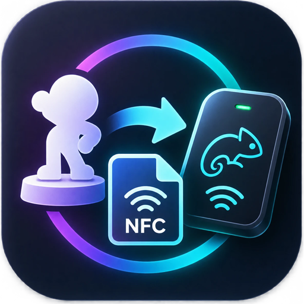

<p align="center">
  
</p>

<h1 align="center">Amiibo Forge</h1>

<p align="center">
  Convierte tus copias <code>.bin</code> de amiibo en archivos listos para emular en el <b>Chameleon Ultra</b>.<br>
  Una sola página web, servida desde un contenedor Docker. La conversión ocurre en tu navegador.
</p>

<p align="center">
  <a href="https://github.com/twindragon97/amiibo-forge/actions/workflows/docker.yml"></a>
</p>

---

## Qué hace

Una copia de amiibo es la imagen completa de un chip NTAG215: 540 bytes en 135 páginas de 4 bytes. Casi todas las copias traen en blanco la **contraseña de escritura** (página 133) y su respuesta **PACK** (página 134). La Switch se autentica con esa contraseña, y el Chameleon Ultra la compara con lo que guarda el archivo. Sin ella, el amiibo no funciona.

Amiibo Forge:

1. **Valida** cada archivo: tamaño, prefijo `04` de NXP, los bytes de control del UID (BCC0 y BCC1), la cabecera `F1 10 FF EE` y el marcador `A5` de amiibo.
2. **Calcula la contraseña** a partir de los 7 bytes del UID y la escribe en la página 133, con `80 80` como PACK en la 134. No toca nada más: solo cambian 6 bytes.
3. Te deja **descargar** cada archivo, o todos en un `.zip`.

Acepta archivos de **540**, **532** (sin las páginas 133–134) y **572** bytes (con 32 bytes de firma), y packs con muchos amiibo seguidos, que separa en archivos individuales.

```
PWD[0] = AA ⊕ UID[1] ⊕ UID[3]
PWD[1] = 55 ⊕ UID[2] ⊕ UID[4]
PWD[2] = AA ⊕ UID[3] ⊕ UID[5]
PWD[3] = 55 ⊕ UID[4] ⊕ UID[6]
PACK   = 80 80
```

> Tus archivos no se suben a ningún servidor. El contenedor solo entrega la página; la lectura, la conversión y la descarga ocurren en el navegador.

## Puesta en marcha

Necesitas Docker con Docker Compose.

```bash
curl -O https://raw.githubusercontent.com/twindragon97/amiibo-forge/main/docker-compose.yml
docker compose up -d
```

Abre **http://localhost:8080**.

O sin Compose:

```bash
docker run -d --name amiibo-forge -p 8080:80 --restart unless-stopped ghcr.io/twindragon97/amiibo-forge:latest
```

Para cambiar el puerto, edita `"8080:80"` en `docker-compose.yml` (por ejemplo `"9000:80"`).

### Actualizar

```bash
docker compose pull
docker compose up -d
```

### Construir desde el código

```bash
git clone https://github.com/twindragon97/amiibo-forge.git
cd amiibo-forge
docker compose -f docker-compose.build.yml up -d --build
```

## Cargar el amiibo en el Chameleon Ultra

Con [Chameleon Ultra GUI](https://github.com/GameTec-live/ChameleonUltraGUI):

1. Abre **Saved Cards** y pulsa el icono de subir archivo en la cabecera de **Cards**.
2. Elige el `.bin` convertido. La app lo detecta como **NTAG215** por su tamaño.
3. En **Correct tag details**, comprueba: tipo `NTAG215`, UID de 7 bytes (el mismo que muestra Amiibo Forge), `SAK 00` y `ATQA 00 44`. Pulsa **Save as 7 byte UID**.
4. Ve a **Slot Manager**, toca un slot y elige la tarjeta. Espera a que termine *Uploading dump to emulator…*.
5. Selecciona ese slot en el Chameleon con los botones A/B y acércalo al lector NFC de la consola.

Caben 8 amiibo a la vez, uno por slot.

<details>
<summary>Con la CLI oficial (<code>chameleon_cli</code>)</summary>

```text
hw slot change -s N
hw slot type -s N -t NTAG_215
hw slot enable -s N --hf
hf mfu eload -f amiibo.bin
hf mfu econfig -s N --uid <UID de 7 bytes en hex>
```

`eload` solo carga las páginas; el UID que ve el lector se configura aparte con `econfig`. `hw slot type` borra el slot, así que va antes de `eload`.
</details>

## Problemas frecuentes

| Síntoma | Qué hacer |
| --- | --- |
| La consola no reconoce el amiibo | Actualiza el firmware del Chameleon desde la GUI y vuelve a importar el archivo. Comprueba que el slot sea NTAG215. |
| Archivo en rojo | No es un NTAG215 válido: el tamaño o los bytes de control del UID no cuadran. Busca otra copia. |
| Archivo en ámbar | Se convirtió, pero algún byte no es el típico de un amiibo. Pruébalo; si falla, busca otra copia. |
| ¿Hace falta `key_retail.bin`? | No. Las claves solo sirven para descifrar o editar los datos; aquí la copia se emula tal cual. |
| ¿Puedo cambiar el UID? | No. Los datos del amiibo están firmados junto con el UID original. |

## Imagen Docker

GitHub Actions construye y publica la imagen en GitHub Container Registry para `linux/amd64` y `linux/arm64` (Raspberry Pi incluida):

| Evento | Etiquetas |
| --- | --- |
| Push a `main` | `latest`, `sha-<commit>` |
| Tag `v1.2.3` | `1.2.3`, `1.2`, `sha-<commit>` |
| Pull request | Solo se construye, no se publica |

Para publicar una versión:

```bash
git tag v1.0.0
git push origin v1.0.0
```

## Estructura

```
.
├── web/                     # Lo que sirve nginx
│   ├── index.html           # La aplicación completa (HTML + CSS + JS)
│   ├── favicon.ico
│   ├── favicon-32.png
│   └── apple-touch-icon.png
├── assets/
│   ├── icon.png             # Icono del proyecto (512 px)
│   └── icon-original.webp   # Icono original
├── nginx.conf
├── Dockerfile
├── docker-compose.yml       # Usa la imagen de GHCR
├── docker-compose.build.yml # Construye la imagen en local
└── .github/workflows/docker.yml
```

## Aviso

Amiibo Forge es un proyecto personal sin relación con Nintendo ni con RfidResearchGroup. Úsalo solo con copias de amiibo que te pertenezcan.

## Licencia

[MIT](LICENSE)
